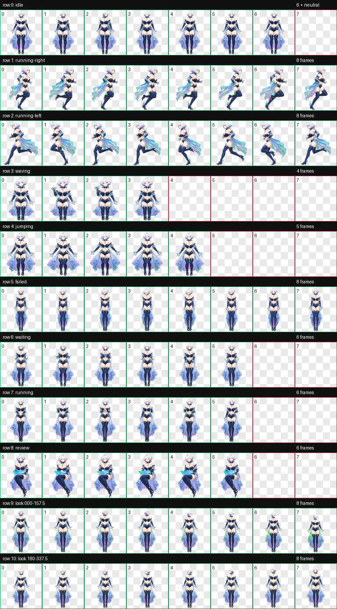

# Nerrise

Nerrise is the version archive for **Nerisse**, a custom animated Codex desktop pet. She is a moonlit digital guardian with a silver-and-blue jellyfish haircut, an ornate navy/cyan outfit, a compact hourglass silhouette, and eleven complete animation rows.

The repository name uses **Nerrise**; the installed pet ID and display name remain **Nerisse** for compatibility with the existing Codex package.



## Latest version

**v8.0.0 — Seated Hologram Review** adds an active six-frame review loop in which Nerisse sits cross-legged, scans a connected holographic panel, taps, swipes, blinks, and returns smoothly to the opening pose.


[Download the latest release](https://github.com/J3DI-19/Nerrise/releases/latest)

## Install in Codex

Download and extract a release archive, then copy `pet.json` and `spritesheet.webp` into:

```text
%USERPROFILE%\.codex\pets\nerisse\
```

PowerShell example from a checked-out repository:

```powershell
$petDir = Join-Path $env:USERPROFILE ".codex\pets\nerisse"
New-Item -ItemType Directory -Force -Path $petDir | Out-Null
Copy-Item .\versions\v8.0.0\pet.json $petDir -Force
Copy-Item .\versions\v8.0.0\spritesheet.webp $petDir -Force
```

If Codex is already open, switch pets or restart the app to refresh a cached atlas.

## Version history

| Release | Name | Main change |
|---|---|---|
| [v1.0.0](versions/v1.0.0) | Original Guardian | First complete ethereal guardian and v2 animation atlas. |
| [v2.0.0](versions/v2.0.0) | High Quality | Smoother non-pixel rendering and repaired animation playback. |
| [v3.0.0](versions/v3.0.0) | Character Remake | More confident mature design, shorter hair, and revised proportions. |
| [v4.0.0](versions/v4.0.0) | Jellyfish HD | Jellyfish haircut, cool-blue translucent-looking outfit layers, and reduced height. |
| [v5.0.0](versions/v5.0.0) | Large & Clean | Cleaner skin and facial rendering, restrained palette, and wider compact silhouette. |
| [v6.0.0](versions/v6.0.0) | Wide & Short | Restored v4 detail while enlarging the face and improving the hourglass proportions. |
| [v7.0.0](versions/v7.0.0) | Flirty Idle | New expressive idle loop while preserving every other v6 animation row. |
| [v8.0.0](versions/v8.0.0) | Hologram Review | Seated holographic review interaction with scan, tap, swipe, and coy blink. |

See [CHANGELOG.md](CHANGELOG.md) for detailed release notes.

## Format and validation

Every published version is a Codex `spriteVersionNumber: 2` package:

- Atlas: lossless transparent WebP, `1536 × 2288`
- Grid: `8 × 11` cells, each `192 × 208`
- Standard animation rows: idle, directional movement, wave, jump, failure, waiting, running/working, and review
- Look system: 16 clockwise look directions across rows 9–10
- Package files: `pet.json` and `spritesheet.webp`
- QA artifacts: contact sheets, animation previews, and version-specific validation reports where available

All eight archived atlases were revalidated before publication and passed with no errors or warnings.

## Repository layout

```text
versions/
  v1.0.0/ ... v8.0.0/   final packages and QA artifacts
.github/release-notes/   release descriptions used on GitHub
CHANGELOG.md              chronological development notes
```

Temporary image-generation runs, duplicate rollback packages, and local installation files are intentionally excluded from Git history.

## Rights

Copyright © 2026 J3DI-19. See [LICENSE](LICENSE). Personal installation and evaluation are permitted; redistribution and reuse require written permission.

